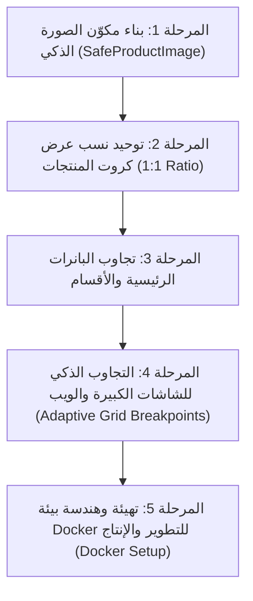

# خطة التطوير الشاملة: تجاوب الشاشات، مرونة الصور، وإعداد Docker

---

## الأهداف الأساسية
1. **تجاوب كامل 100%:** دعم جميع الشاشات من أصغر الهواتف (320px مثل iPhone SE) مروراً بالهواتف الحديثة والتابلت، وحتى شاشات الكمبيوتر والويب (Desktop حتى 4K).
2. **عرض محمي ومرن ضد الصور المخالفة:** ضمان أن أي صورة يرفعها الموظف (سواء كانت مربعة أو طولية أو مستطيلة أو بدون هامش) تظهر بدون أي قص أو تشويه.
3. **بيئة تشغيل Docker احترافية:** إعداد حاويات Docker مجهزة للتطوير والإنتاج (Multi-stage Dockerfile و Docker Compose) لنشر التطبيق بنقرة واحدة على أي خادم سحابي أو جهاز محلي.
4. **التناغم التام مع ملف المعايير:** توافق كامل بين كود التطبيق وملف معايير الصور.

---

## المرحلة الأولى: تشخيص المشاكل الحالية في الكود

| المشكلة في الكود الحالي | مكان المشكلة | التأثير على تجربة المستخدم والتشغيل |
| :--- | :--- | :--- |
| **ارتفاعات صور ثابتة بالأرقام (`height: 154`, `height: 174`, `height: 300`)** | `app/(tabs)/index.tsx` `app/category/[name].tsx` `app/product/[id].tsx` | قص رؤوس وقواعد المنتجات إذا كانت الصورة غير متطابقة 100% مع الارتفاع الثابت. |
| **استخدام `resizeMode="cover"` إجبارياً** | بطاقات المنتجات وتفاصيل المنتج | قص جوانب أو أطراف المنتج عند اختلاف نسبة الأبعاد. |
| **تثبيت أبعاد الشاشة لمرة واحدة `Dimensions.get("window")` خارج المكون** | `app/(tabs)/index.tsx` (السطر 19) | انعدام التجاوب عند تغيير حجم نافذة المتصفح على الكمبيوتر أو تدوير الجوال. |
| **تثبيت عدد الأعمدة بمنتجين فقط `numColumns={2}`** | جميع شاشات القوائم والكتالوج | ظهور كروت المنتجات بحجم عملاق ومشوه على شاشات التابلت وشاشات الكمبيوتر. |
| **ارتفاع البانر ثابت بـ 205 بكسل `height: 205`** | الصفحة الرئيسية `index.tsx` | تمدد البانر بشكل شريطي رفيع ومشوّه على شاشات الديسكتوب، وتصادم النصوص والزر في الشاشات الصغيرة. |
| **إعدادات Docker الحالية محدودة للتطوير فقط** | `docker/Dockerfile` و `docker/docker-compose.yml` | تفتقر لإعدادات الإنتاج (Production Build Nginx / Node Standalone)، وحجم الحاوية كبير بدون كاش فعال. |

---

## المرحلة الثانية: خطة التنفيذ خطوة بخطوة

---

### الخطوة 1: مكوّن الصورة المرن الذكي (`SafeProductImage`)
- **حاوية مربعة بنسبة `aspectRatio: 1`:** تلائم الكادر تلقائياً مهما كان عرض العمود.
- **عرض احترافي `resizeMode="contain"`:** يضمن ظهور المنتج كاملاً (سواء كان طويلاً مثل ماسكارا أو فرشاة، أو عريضاً مثل باليت ظلال العيون) بدون أي قص نهائياً.
- **خلفية بيضاء موحدة `#FFFFFF`:** تدمج أي مساحات فارغة تلقائياً فتظهر كأنها خلفية طبيعية للصورة.
- **حماية ضد الروابط التالفة (Image Error Handling):** في حال كان الرابط مكسوراً أو لم يحمّل، تظهر أيقونة بديلة أنيقة فوراً.

---

### الخطوة 2: إصلاح شبكة المنتجات وتجاوب الأعمدة (Adaptive Responsive Grid)
- استبدال `Dimensions.get("window")` بـ `useWindowDimensions()`.
- حساب عدد الأعمدة ديناميكياً:
  - **شاشات الجوال العادية والصغيرة (< 600px):** عمودان (`numColumns = 2`).
  - **الأجهزة اللوحية والتابلت (600px إلى 1024px):** 3 أعمدة (`numColumns = 3`).
  - **شاشات الكمبيوتر والويب (> 1024px):** 4 أعمدة مع حصر العرض الأقصى للصفحة في `maxWidth: 1280px` في المنتصف.

---

### الخطوة 3: حماية وضبط الشاشات الصغيرة جداً (320px - 360px)
- **أزرار الشراء في الكارت:** ضبط التخطيط بحيث إذا كان عرض الشاشة صغيراً، ينتقل السعر وزر الإضافة لترتيب عمودي مرن بدلاً من التصادم الأفقي.
- **شبكة تصنيفات الأقسام:** جعل كروت الأقسام تدعم التمرير أو الاحتواء السلس بدلاً من القسمة الحرفية على 3 التي تؤدي لتكسر النصوص العربية.

---

### الخطوة 4: تجاوب البانرات
- تحويل ارتفاع البانر من رقم ثابت إلى نسبة عرضية بنسبة `aspectRatio: 2 / 1` أو `2.2 / 1`.
- تصغير حجم خطوط البانر تلقائياً على الشاشات الأصغر من 360px لمنع تداخل النصوص.

---

### الخطوة 5: حزمة Docker المتكاملة (Development + Production)
- **ملف متعدد المراحل (Multi-stage Dockerfile):**
  - مرحلة `development`: لتشغيل خادم التطوير مع الـ Hot Reload.
  - مرحلة `production`: لعمل Export ثابت وتشغيله عبر خادم Nginx خفيف وسريع ومؤمن.
- **ملف `docker-compose.yml` محدث:** يوفر بيئة تشغيل متكاملة ومستقلة تماماً.

